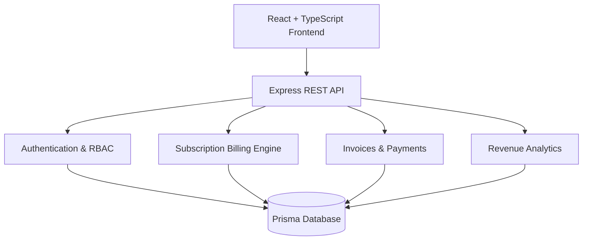
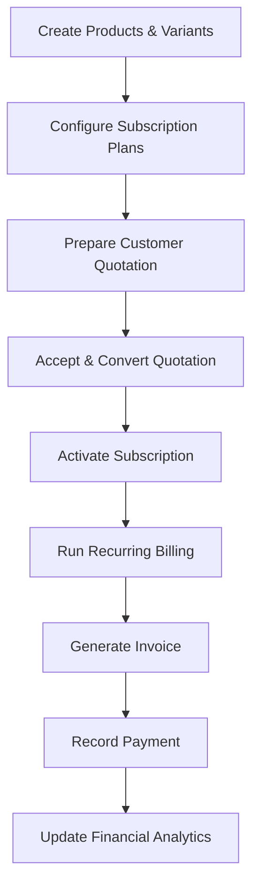

<div align="center">

# ◈ SubFlow

### Subscription Management. Revenue Intelligence. One Seamless Flow.

**A modern subscription billing and recurring revenue management platform.**

Built with precision by **Team Brightloop** for the  
**Odoo × Make-A-Ton 9.0 Hackathon — 2026**


**[Explore Features](#-features) · [Architecture](#-system-architecture) · [Getting Started](#-getting-started) · [Demo Workflow](#-hackathon-demonstration)**

</div>

---

## ✦ The Vision

Subscription businesses shouldn't need disconnected spreadsheets, manual invoices, and complicated tools to manage recurring revenue.

**SubFlow brings the entire subscription lifecycle into one unified workspace.**

From the first quotation to recurring billing, payment reconciliation, and revenue analytics, SubFlow helps businesses manage subscriptions with clarity and control.

> **One platform. Every subscription. Complete financial visibility.**

---

## ◈ The Problem

Managing recurring subscriptions introduces several operational challenges:

- Manual and repetitive invoice generation
- Difficulty tracking recurring billing schedules
- Fragmented customer and subscription records
- Complex product variants and pricing
- Errors in tax and discount calculations
- Poor visibility into outstanding payments
- Limited understanding of recurring revenue
- Lack of convenient customer self-service

These problems become increasingly difficult as a business grows.

### Our Solution

SubFlow centralizes subscription operations and connects previously fragmented processes.

| Traditional Approach | With SubFlow |
| :--- | :--- |
| Manual invoice creation | Automated recurring billing |
| Scattered customer records | Centralized customer management |
| Manual payment tracking | Integrated payment ledger |
| Spreadsheet-based reporting | Financial analytics dashboard |
| Disconnected quotations | Quotation-to-subscription workflow |
| Limited customer visibility | Dedicated self-service portal |

---

## ✨ Features

### 01 — Subscription Lifecycle Management

Manage recurring subscriptions across their lifecycle.

- Create and manage subscriptions
- Configure billing schedules
- Track subscription status
- Manage renewal and expiration dates
- Associate customers, products, and plans
- Access related invoice records

### 02 — Automated Recurring Billing

A dedicated billing engine processes subscriptions according to their configured billing frequency.

Supported frequencies:

| Frequency | Billing Interval |
| :--- | :--- |
| Daily | Every day |
| Weekly | Every 7 days |
| Monthly | Every calendar month |
| Yearly | Every calendar year |

Additional capabilities:

- Scheduled billing execution
- Manual billing triggers
- Invoice generation
- Billing-period tracking
- Tax and discount calculations
- Duplicate-billing prevention mechanisms

### 03 — Product and Variant Management

Build a flexible product catalogue with configurable pricing.

- Product creation and management
- Multiple product variants
- Variant-specific price adjustments
- Product availability management
- Integration with quotations and subscriptions

### 04 — Smart Quotations

Move from commercial proposals to active subscriptions.

- Create structured quotations
- Add multiple products and variants
- Apply configured taxes and discounts
- Calculate quotation totals
- Manage quotation statuses
- Convert accepted quotations into subscriptions

### 05 — Invoice Management

A centralized financial ledger for subscription invoices.

- Automatically generated invoices
- Invoice status tracking
- Outstanding balance monitoring
- Partial and full payment tracking
- Search and filtering
- Downloadable PDF invoices

### 06 — Payment Reconciliation

Track incoming payments against customer invoices.

Supported payment methods include:

- UPI
- Bank transfer
- Credit card
- Debit card
- Cash
- Other recorded payment methods

Each payment is associated with its invoice and customer.

### 07 — Revenue Analytics

Monitor key subscription-business metrics.

| Metric | Purpose |
| :--- | :--- |
| MRR | Monthly Recurring Revenue |
| ARR | Annual Recurring Revenue |
| Collected Revenue | Recorded payment collections |
| Outstanding Receivables | Unpaid invoice balances |
| Overdue Amounts | Payments past their due dates |
| Revenue Trends | Revenue activity over time |

### 08 — Customer Self-Service Portal

Customers have a dedicated interface to:

- View active subscriptions
- Review available plans
- Access invoices
- Review payment history
- Manage profile information

Customer records are scoped through role-based access controls.

---

## 🔐 Role-Based Access Control

SubFlow supports three user roles.

| Capability | Admin | Staff | Customer |
| :--- | :---: | :---: | :---: |
| Internal dashboard | ✅ | ✅ | — |
| Product management | ✅ | ✅ | — |
| Subscription management | ✅ | ✅ | Own records |
| Quotations | ✅ | ✅ | — |
| Invoice management | ✅ | ✅ | Own invoices |
| Payment recording | ✅ | ✅ | — |
| Customer portal | — | — | ✅ |
| User administration | ✅ | — | — |
| System configuration | ✅ | Limited | — |
| Revenue analytics | ✅ | ✅ | — |

Access controls are implemented in frontend routing and backend middleware.

---

## 🏗 System Architecture



### Technology Stack

| Layer | Technologies |
| :--- | :--- |
| Frontend | React 18, TypeScript, Vite |
| Styling | Tailwind CSS, custom design system |
| Routing | React Router |
| Forms | React Hook Form, Zod |
| Visualizations | Recharts |
| Backend | Node.js, Express, TypeScript |
| ORM | Prisma |
| Database | SQLite / PostgreSQL |
| Authentication | JWT, bcryptjs, HTTP-only cookies |
| Billing Scheduler | node-cron |
| PDF Generation | PDFKit |
| Email | Nodemailer |
| Financial Calculations | Decimal.js |

---

## 🔄 How SubFlow Works

The platform connects commercial operations to the recurring revenue lifecycle.



### Billing Reliability

The billing engine includes:

- Billing-period tracking
- Database-backed invoice creation
- Transactional operations
- Unique billing-period constraints
- Retry handling for certain database conflicts

Concurrency and high-volume performance testing remain part of the final verification process.

---

## 📁 Project Structure

```text
subflow/
│
├── client/
│   ├── src/
│   │   ├── api/
│   │   ├── components/
│   │   ├── context/
│   │   ├── pages/
│   │   │   ├── admin/
│   │   │   ├── customer/
│   │   │   └── public/
│   │   ├── App.tsx
│   │   └── index.css
│   └── package.json
│
├── server/
│   ├── prisma/
│   │   ├── schema.prisma
│   │   ├── schema.postgresql.prisma
│   │   └── seed.ts
│   ├── src/
│   │   ├── config/
│   │   ├── middleware/
│   │   ├── routes/
│   │   ├── services/
│   │   ├── tests/
│   │   └── index.ts
│   └── package.json
│
├── docs/
│   └── billing-engine.md
│
└── package.json
```

---

## 🚀 Getting Started

### Prerequisites

Ensure you have:

- Node.js 18+
- npm 9+
- Git

### 1. Clone the Repository

```bash
git clone https://github.com/thor-1933/odoo-subscription-management.git
cd odoo-subscription-management/subflow
```

### 2. Install Dependencies

```bash
npm install
npm --prefix server install
npm --prefix client install
```

### 3. Environment Configuration

Create `server/.env` using `server/.env.example` as a reference.

For local development:

```env
PORT=5000
NODE_ENV=development
DATABASE_URL="file:./dev.db"
JWT_SECRET="YOUR_OWN_RANDOM_SECRET_AT_LEAST_32_CHARACTERS"
CLIENT_URL="http://localhost:5173"
ENABLE_BACKGROUND_SCHEDULER="false"
```

Replace the JWT placeholder with a unique, securely generated value.

Never commit real credentials or `.env` files.

### 4. Initialize the Database

For a new, disposable SQLite database:

```bash
npm run db:generate
npm run db:push
```

### 5. Load Demo Data

**Warning:** The seed script deletes existing records.

Only use it with a verified disposable development database.

From the `server` directory, set `SEED_ALLOW_RESET=true` in your shell and run:

```bash
npm run db:seed
```

Do not execute this against a production or important database.

### 6. Start the Application

Open two terminals inside the `subflow` directory.

**Terminal 1 — Backend**

```bash
npm run dev:server
```

**Terminal 2 — Frontend**

```bash
npm run dev:client
```

### Local URLs

| Service | URL |
| :--- | :--- |
| Frontend | http://localhost:5173 |
| Backend | http://localhost:5000 |
| Health Check | http://localhost:5000/health |

---

## 🧪 Hackathon Demonstration

The following walkthrough demonstrates the intended end-to-end workflow.

| Step | Action | Expected Result |
| :---: | :--- | :--- |
| 01 | Admin login | Access internal dashboard |
| 02 | Open product catalogue | View products and variants |
| 03 | Configure subscription plan | Select billing frequency |
| 04 | Create customer quotation | Calculate quotation details |
| 05 | Convert accepted quotation | Create subscription |
| 06 | Run billing | Generate eligible invoices |
| 07 | Open invoice ledger | Review generated invoices |
| 08 | Record partial payment | Reduce outstanding balance |
| 09 | Complete payment | Update invoice to paid |
| 10 | Customer login | View customer-specific records |

Use an isolated demo database for financial write operations.

---

## ⚡ Performance & Scalability

The hackathon problem statement specifies a target of **two-second page response times**, including scenarios with thousands of subscriptions.

The application includes a performance benchmark utility and database query optimizations.

However, representative end-to-end response-time measurements with thousands of subscriptions are still pending verification.

The existing benchmark writes synthetic records and invokes billing. It should only be used with an isolated test database.

We do not claim the performance target has been achieved without measured evidence.

---

## 🧪 Testing

Build the frontend and backend:

```bash
npm run build
```

The repository also includes automated tests:

```bash
npm test
```

**Important:** Some tests execute financial data-changing operations. Run them only against a disposable test database.

---

## 🌐 Deployment Architecture

The project includes configuration for:

| Service | Platform |
| :--- | :--- |
| Frontend | Vercel |
| Backend API | Render |
| Database | Neon PostgreSQL |

Production deployment requires valid environment variables, explicit PostgreSQL Prisma schema selection, trusted frontend origins, and secure secrets.

Deployment readiness is subject to final verification.

---

## 🛡 Security & Reliability

SubFlow includes:

- Role-based access controls
- Password hashing
- HTTP-only authentication cookies
- JWT-based authentication
- Trusted-origin checks
- Authentication rate limiting
- Customer data scoping
- Transactional financial operations
- Database constraints

Further security, concurrency, and deployment verification is ongoing.

---

## 👥 Team Brightloop

Developed for the **Odoo × Make-A-Ton 9.0 Hackathon (2026)**.

| Team Member | Contribution |
| :--- | :--- |
| Sri Charan Garlapati | Add verified responsibilities |
| Team Member 2 | Add name and verified contribution |
| Team Member 3 | Add name and verified contribution |
| Team Member 4 | Add name and verified contribution |

Update this section to reflect the actual team roster and work performed.

---

## 📌 Project Status

**Current stage:** Feature implementation completed; final validation and optimization in progress.

### Implemented

- Subscription lifecycle management
- Recurring billing engine
- Quotations and conversion
- Invoice generation
- Payment reconciliation
- Role-specific interfaces
- Financial analytics
- Customer self-service

### Final Verification

- [ ] End-to-end billing regression tests
- [ ] Concurrent payment and billing tests
- [ ] Two-second response-time validation
- [ ] Production deployment verification
- [ ] Full accessibility and mobile testing

---

<div align="center">

### ◈ SubFlow

**From first quotation to recurring revenue — everything in one flow.**

Made by **Team Brightloop**  
Odoo × Make-A-Ton 9.0 · 2026

</div>
